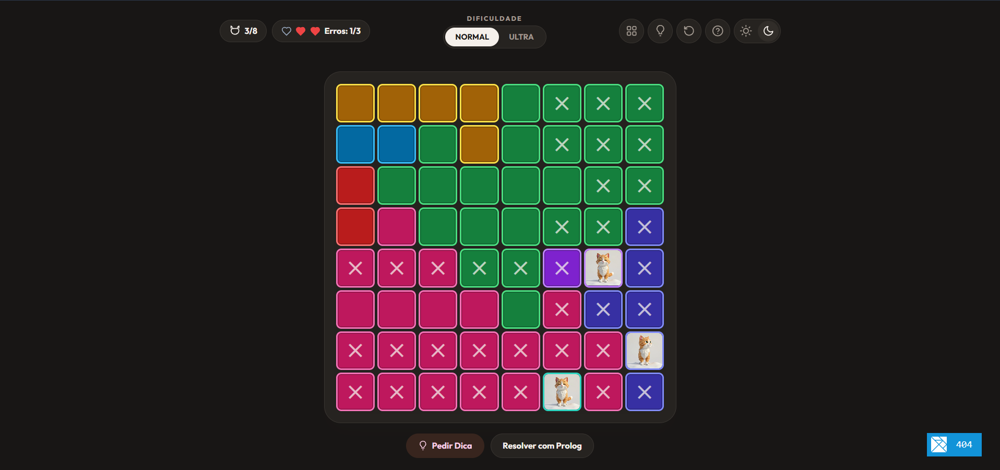

# Meowdoku

## 1. Identificação

| Nome completo | Matrícula | Turma (14h/16h) | Usuário GitHub |
|---------------|-----------|-----------------|----------------|
| Gabriel Santos Monteiro | 221021975 | 16h | @GabrielSMonteiro |
| Ana Luíza Fernandes | 211030667 | 16h | @analufernanndess |
| Cayo Alencar | 221022506 | 16h | @Cayoalencar |
| Gabriel Marques de Souza | 202016266 | 16h | @GabrielMS00 |
| Paola Nascimento | 211062713 | 16h | @paolaalim |
| Renata Quadros Kurzawa | 211063013 | 16h | @RenataKurzawa |
| Tales R. G. | 211041295 | 16h | @TalesRG |

- **Nome do projeto:** Meowdoku
- **Nome do grupo:** Grupo 01 - Meowdoku
- **Repositório:** https://github.com/Paradigmas-Grupo01/meow-Game
- **Commit ou tag entregue:** `ae9af37`
- **Ponto de partida:** remix original
- **Slides da apresentação oral:** não há

## 2. Resumo

O Meowdoku adapta a mecânica de jogos lógicos como Star Battle e Queens para um tema felino. O jogador recebe um tabuleiro quadrado dividido em regiões coloridas e precisa posicionar uma quantidade determinada de gatos em cada linha, coluna e território, com a condição obrigatória de que nenhum gato toque outro, nem mesmo pelas diagonais. Todas as regras de posicionamento, a resolução do tabuleiro, a geração de variações conexas com solução única e as deduções de dicas foram desenvolvidas em SWI-Prolog utilizando programação lógica por restrições com CLP(FD), enquanto a interface visual gamificada (com controle de 3 vidas, arraste de células, seletor de fases e alto contraste) foi implementada em Elm.




## 3. Como executar

**Requisitos** (com as versões que o grupo usou):

- SWI-Prolog 9.x ou 10.x
- Node.js 20.x
- Python 3.11 ou superior com `uv` (ou `venv` com FastAPI, Uvicorn e Janus)

**Instalação e execução:**

```sh
# Terminal 1: Backend FastAPI com SWI-Prolog
cd backend
uv sync
uv run fastapi dev app/main.py
# Alternativa sem uv:
# python -m venv .venv && .venv\Scripts\activate
# pip install fastapi uvicorn pydantic janus-swi
# python -m uvicorn app.main:app --reload --port 8000

# Terminal 2: Frontend Elm com Vite
cd frontend
npm install
npm run dev
```

A interface web pode ser acessada no navegador pelo endereço `http://localhost:5173`. A documentação interativa das rotas da API pode ser consultada em `http://localhost:8000/docs`.

**Testes:**

```sh
# Testes unitários em Prolog com plunit (16 casos de teste)
swipl -g run_tests -t halt backend/prolog/test_meowdoku.pl

# Testes de integração da API em Python com pytest
cd backend && uv run pytest

# Testes unitários de domínio em Elm com elm-test (34 casos de teste)
cd frontend && npx elm-test
```

**Testado em:** Windows 11 e Linux Ubuntu 22.04, Google Chrome

## 4. Arquitetura

A aplicação é dividida em três camadas com papéis bem definidos. No navegador, o frontend em Elm renderiza o tabuleiro e gerencia as ações do usuário. Quando é necessário iniciar uma partida, pedir uma dica dedutiva ou calcular a solução completa, o frontend envia requisições HTTP para a API em FastAPI. O módulo em Python atua como intermediário sem lógica própria de jogo, repassando os dados via biblioteca Janus diretamente para o SWI-Prolog, onde as restrições lógicas são avaliadas.

```
[Elm (Frontend)] --HTTP/JSON--> [FastAPI (Python)] --janus--> [SWI-Prolog (CLP/FD)]
```

| Parte | Responsabilidade | Arquivos principais |
|---|---|---|
| Prolog | Modela o problema com CLP(FD), resolve o tabuleiro via labeling, valida soluções, gera variações conexas com solução única e deduz dicas de jogada | `backend/prolog/meowdoku.pl`, `backend/prolog/test_meowdoku.pl` |
| Elm | Renderiza a grade no padrão TEA, controla cliques simples/duplos e arraste nas células, gerencia vidas/fases e calcula conflitos locais imediatos | `frontend/src/Meowdoku.elm`, `frontend/src/Main.elm`, `frontend/src/Api.elm`, `frontend/tests/MeowdokuTest.elm` |
| Python | Fornece as rotas REST em FastAPI, valida o formato com Pydantic e se comunica com o SWI-Prolog pelo Janus | `backend/app/main.py`, `backend/app/meowdoku_prolog.py`, `backend/tests/test_api.py` |

## 5. Parte em Prolog

### 5.1 Predicados principais

| Predicado | Local | O que faz |
|---|---|---|
| `solve(+Regions, +CatsPerUnit, -Solution)` | `backend/prolog/meowdoku.pl:16` | Recebe a matriz de regiões e a quantidade de gatos por unidade, devolvendo uma matriz binária com as posições dos gatos que respeitam todas as restrições. |
| `valid_solution(+Regions, +Board, +CatsPerUnit)` | `backend/prolog/meowdoku.pl:94` | Confere deterministicamente se um tabuleiro preenchido cumpre todas as regras do jogo, sem disparar busca por rotulação. |
| `enforce_no_touch(+Grid)` | `backend/prolog/meowdoku.pl:64` | Percorre a grade por recursão e impõe a inequação `A + B #=< 1` entre todas as células vizinhas ortogonais e diagonais. |
| `hint(+Regions, +Board, +CatsPerUnit, -Hint)` | `backend/prolog/meowdoku.pl:142` | Analisa a situação atual da partida e sugere uma jogada fundamentada, retornando a posição, o valor e uma explicação textual. |
| `has_unique_solution(+Regions, +CatsPerUnit)` | `backend/prolog/meowdoku.pl:135` | Testa se um mapa possui uma única solução possível, buscando no máximo duas respostas com `findnsols/4`. |
| `generate(+Size, +CatsPerUnit, -Regions, -Solution)` | `backend/prolog/meowdoku.pl:205` | Gera variações de mapas transferindo células de fronteira sem desconectar territórios (`region_connected/2`) e garantindo solução única. |
| `example_puzzle(+Name, -Size, -CatsPerUnit, -Regions)` | `backend/prolog/meowdoku.pl:254` | Contém 16 tabuleiros pré-configurados e validados para os tamanhos 6x6, 8x8, 9x9, 10x10 e 11x11 no modo clássico (`K=1`) e 8x8 no modo avançado (`K=2`). |

### 5.2 Conceitos do paradigma lógico utilizados

- [x] Fatos e regras como base de conhecimento: banco de tabuleiros pré-configurados e regras de dedução textual de dicas em `backend/prolog/meowdoku.pl:142-201,254-443`.
- [x] Unificação e casamento de padrões: desestruturação de listas de coordenadas, pares `R-C` e termos compostos `hint/4` e `move/4` em `backend/prolog/meowdoku.pl:57-62,142-160,215-228`.
- [x] Recursão (inclusive sobre listas): percurso sistemático da grade por meio de `enforce_rows/4`, `enforce_cols/4` e busca em largura `flood_region/2` em `backend/prolog/meowdoku.pl:70-78,248-252`.
- [x] Backtracking e múltiplas soluções: busca com rotulação `labeling([ff, bisect], Cells)` e permutação de fronteiras em `backend/prolog/meowdoku.pl:30,225-228`.
- [x] `findall/3`, `bagof/3`, `setof/3` ou similares: coleta de mapas e movimentos candidatos com `findall/3` (`backend/prolog/meowdoku.pl:206,216,244`) e contagem limitada a 2 soluções com `findnsols/4` em `unique_solution/3` (`backend/prolog/meowdoku.pl:138-140`).
- [x] Corte (`!`) ou negação (`\+`), e por que foram necessários: uso de corte em `filter_cells_by_region/4` (`backend/prolog/meowdoku.pl:59`) e na seleção da dica prioritária em `hint/4` (`backend/prolog/meowdoku.pl:149`), evitando buscas redundantes, além de negação por falha `\+` em `check_no_touch_strict/1` (`backend/prolog/meowdoku.pl:123`).
- [x] Programação por restrições (CLP(FD) ou outra): definição do domínio binário `0..1`, somatórios de linha, coluna e região com `#=`, e restrições de vizinhança com `#=<` em `backend/prolog/meowdoku.pl:22-30,80-88`.
- [x] Predicados de ordem superior (`maplist`, `foldl`, `include` e correlatos): aplicação uniforme de restrições em matrizes usando `maplist/2` (`backend/prolog/meowdoku.pl:20-25,98-101`) e filtragem de fronteira com `partition/4` em `flood_region/2` (`backend/prolog/meowdoku.pl:250`).

### 5.3 Trecho em destaque

```prolog
constrain_neighbors(Grid, R, C, N) :-
    get_cell(Grid, R, C, CellA),
    C1 is C + 1,
    ( C1 < N -> get_cell(Grid, R, C1, CellR), CellA + CellR #=< 1 ; true ),
    R1 is R + 1,
    ( R1 < N -> get_cell(Grid, R1, C, CellD), CellA + CellD #=< 1 ; true ),
    ( (R1 < N, C1 < N) -> get_cell(Grid, R1, C1, CellDR), CellA + CellDR #=< 1 ; true ),
    C0 is C - 1,
    ( (R1 < N, C0 >= 0) -> get_cell(Grid, R1, C0, CellDL), CellA + CellDL #=< 1 ; true ).
```

Escolhemos esse trecho do arquivo `backend/prolog/meowdoku.pl` (linhas 80 a 88) porque ele resolve a regra de não adjacência de forma declarativa e direta. Em vez de escrever laços imperativos checando se as células vizinhas contêm gatos, representamos cada posição como uma variável binária (0 ou 1) e impomos a inequação `CellA + CellB #=< 1` para cada par de casas adjacentes (direita, abaixo, diagonal inferior direita e diagonal inferior esquerda). Como os valores só podem ser 0 ou 1, a soma nunca permite que dois gatos fiquem lado a lado ou na mesma diagonal.

Durante o desenvolvimento, tentamos inicialmente aplicar essa restrição usando `forall/2`, mas descobrimos que a semântica de negação por falha do `forall` desfazia as restrições de CLP(FD) ao retroceder. Reescrevemos a varredura com recursão determinística sobre os índices de linhas e colunas (`enforce_rows/4` e `enforce_cols/4`). Dessa forma, as restrições permanecem ativas na base de restrições do solver durante toda a rotulação (`labeling`), fazendo com que qualquer gato colocado propague imediatamente o valor 0 para todas as oito casas ao redor.

## 6. Parte em Elm

### 6.1 Modelo e mensagens

```elm
type CellMark
    = Empty
    | MarkedX
    | HasCat

type alias Cell =
    { row : Int
    , col : Int
    , regionId : Int
    , mark : CellMark
    , hasConflict : Bool
    }

type alias Board =
    { size : Int
    , catsPerUnit : Int
    , rows : Array (Array Cell)
    }

type Msg
    = GotPuzzle (Result String MeowdokuPuzzle)
    | GotHiddenSolution (Result String (List (List Int)))
    | CellClicked Int Int
    | CellDoubleClicked Int Int
    | DragStarted Int Int
    | DragEntered Int Int
    | DragEnded
    | HintRequested
    | GotHint (Result String MeowdokuHint)
    | SolveRequested
    | GotSolution (Result String (List (List Int)))
    | ResetRequested
    | NewGameRequested
    | SelectPuzzle String
    | ThemeToggled Bool
    | ToggleLevelSelector
    | ToggleRulesModal
    | ErrorDismissed
```

No módulo `frontend/src/Meowdoku.elm` (linhas 27 a 94), criamos o tipo algébrico `CellMark` com os construtores `Empty`, `MarkedX` e `HasCat`, e estruturamos o `Board` com `Array (Array Cell)` para permitir leitura e atualização indexada eficiente em coordenadas `(row, col)`. Essa escolha garante pelo sistema de tipos que uma casa do tabuleiro só possa estar em um desses três estados por vez. Se tivéssemos usado valores booleanos separados para marcar o X e o gato, precisaríamos checar manualmente em vários pontos do código se uma mesma casa não ficou marcada com X e com gato ao mesmo tempo.

Em `frontend/src/Main.elm` (linhas 80 a 99), o tipo `Msg` modela todas as interações da interface, incluindo clique simples (`CellClicked`, para marcar/desmarcar `X`), clique duplo (`CellDoubleClicked`, para posicionar um gato com validação de até 3 erros), eventos de arraste contínuo (`DragStarted`, `DragEntered`, `DragEnded`) e seleção de fases (`SelectPuzzle`). Para as mensagens que envolvem chamadas HTTP, como `GotPuzzle`, `GotHint` e `GotSolution`, utilizamos `Result String a`, obrigando a função `update` a tratar tanto o sucesso quanto mensagens de erro sem risco de exceções em tempo de execução.

### 6.2 Conceitos do paradigma funcional utilizados

- [x] Arquitetura Elm (Model, update, view): organização da aplicação no ciclo reativo padrão com `Browser.element` em `frontend/src/Main.elm:16-24`.
- [x] Custom types e `case` exaustivo: modelagem das marcações com `CellMark` (`frontend/src/Meowdoku.elm:27-79`), erros de API com `ApiError` (`frontend/src/Api.elm:36-38`) e tratamento de eventos com `Msg` (`frontend/src/Main.elm:80-99,234-543`).
- [x] `Maybe` e `Result` no lugar de null e exceções: acesso seguro às células com `getCell` retornando `Maybe Cell` (`frontend/src/Meowdoku.elm:129-132`) e tratamento de respostas HTTP com `Result ApiError a` e `Result String a` (`frontend/src/Api.elm:136-180`).
- [x] Funções de ordem superior e aplicação parcial: contagem e validação de gatos por linha, coluna e região usando `List.filter`, `List.any`, `List.all` e `Array.map` em `frontend/src/Meowdoku.elm:161-242`.
- [x] Composição (`|>`, `>>`): encadeamento de transformações na inicialização do tabuleiro, conversão para matriz e decodificação HTTP em `frontend/src/Meowdoku.elm:97-126,245-280` e `frontend/src/Api.elm:138,158`.
- [x] Decoders e encoders JSON: serialização de matrizes com `Encode.list` e decodificação validada das respostas da API usando `Decode.map4` e `Decode.andThen` em `frontend/src/Api.elm:67-134`.
- [x] Comandos e subscriptions (efeitos controlados): envio de requisições HTTP assíncronas em `Cmd Msg` (`frontend/src/Api.elm:41-64`) e captura global do fim de arraste com `Browser.Events.onMouseUp` em `subscriptions` (`frontend/src/Main.elm:545-551`).
- [x] Imutabilidade e atualização de records: atualização pura do tabuleiro e do estado da partida gerando novas instâncias com `{ board | rows = ... }` em `frontend/src/Meowdoku.elm:145,213,280`.

### 6.3 Trecho em destaque

```elm
checkConflicts : Board -> Board
checkConflicts board =
    let
        catCells =
            List.filter (\cell -> cell.mark == HasCat) (cells board)

        touchesAnotherCat cell =
            if cell.mark /= HasCat then
                False

            else
                catCells
                    |> List.any
                        (\other ->
                            (cell.row /= other.row || cell.col /= other.col)
                                && (abs (cell.row - other.row) <= 1)
                                && (abs (cell.col - other.col) <= 1)
                        )

        exceedsUnit cell =
            if cell.mark /= HasCat then
                False

            else
                (countCatsInRow cell.row board > board.catsPerUnit)
                    || (countCatsInCol cell.col board > board.catsPerUnit)
                    || (countCatsInRegion cell.regionId board > board.catsPerUnit)

        withConflict cell =
            { cell | hasConflict = touchesAnotherCat cell || exceedsUnit cell }
    in
    { board | rows = Array.map (Array.map withConflict) board.rows }
```

O trecho em destaque faz parte do arquivo `frontend/src/Meowdoku.elm` (linhas 182 a 214) e implementa a verificação pura de conflitos diretamente no frontend. A função `checkConflicts` recebe o tabuleiro atual e devolve um novo `Board` com a propriedade `hasConflict` recalculada em cada célula da matriz `Array (Array Cell)`, sem mutação de estado.

Para cada célula que contém um gato (`HasCat`), a função verifica se há outro gato na vizinhança de Chebyshev (`abs (cell.row - other.row) <= 1` e `abs (cell.col - other.col) <= 1`) e confere se a linha, a coluna ou o território ultrapassaram o limite `board.catsPerUnit`. Usando `Array.map (Array.map withConflict)`, todas as linhas e colunas são transformadas de maneira declarativa e a interface reflete qualquer conflito imediatamente, além de ser validada por 20 testes unitários específicos em `frontend/tests/MeowdokuTest.elm`.

## 7. Integração

A comunicação entre a interface em Elm e o motor em Prolog é intermediada por rotas REST em FastAPI. A camada em Python não possui regras do jogo; ela apenas recebe o JSON da requisição, valida o formato e as dimensões com Pydantic e chama os predicados correspondentes no Prolog usando a biblioteca Janus (com suporte a execução via `swipl` como fallback de ambiente), devolvendo a resposta em JSON.

| Rota / chamada | Entrada | Saída | Predicado Prolog |
|---|---|---|---|
| `GET /api/meowdoku/example` | Parâmetro de query `name` com o identificador do puzzle (ex.: `classic_6x6`, `double_8x8`) | JSON com `name`, `size`, `cats_per_unit` e a matriz `regions` (ou HTTP 404 se o exemplo não existir) | `example_puzzle/4` |
| `POST /api/meowdoku/solve` | JSON com a matriz `regions` e a quantidade `cats_per_unit` | JSON com a matriz binária `solution` (ou HTTP 400 se não houver solução / HTTP 422 se o formato for inválido) | `solve/3` |
| `POST /api/meowdoku/hint` | JSON com `regions`, a matriz do `board` atual e `cats_per_unit` | JSON com as coordenadas `row`, `col`, `value` e a explicação `reason` (ou HTTP 400 se completo/sem solução) | `hint/4` |

## 8. Testes e validação

A validação do sistema foi estruturada em três frentes automatizadas, cobrindo o motor de restrições em Prolog, a integração dos endpoints HTTP em Python e a lógica funcional de domínio em Elm.

No SWI-Prolog, criamos uma suíte em `backend/prolog/test_meowdoku.pl` utilizando `plunit` (14 cláusulas `test/1-2`, totalizando 16 execuções com os casos parametrizados de `generate/4`). Os testes cobrem a resolução de tabuleiros 6x6 e 8x8 no modo clássico (`K=1`), a resolução no modo avançado com dois gatos por unidade (`K=2`, totalizando 16 gatos), a detecção de colisões ortogonais e diagonais, o bloqueio de tabuleiros com excesso de gatos por linha ou território, a falha determinística em puzzles sem solução, a verificação de solução única (`has_unique_solution/2`), a geração de partições conexas (`generate/4`) e a geração de dicas dedutivas (`hint/4`). Todos os testes rodam com `swipl -g run_tests -t halt backend/prolog/test_meowdoku.pl`.

No frontend em Elm, implementamos uma suíte com 34 testes unitários em `frontend/tests/MeowdokuTest.elm` usando `elm-explorations/test` (`npx elm-test`). São 20 testes dedicados à função pura `checkConflicts` (validando colisões horizontais, verticais, nas duas diagonais, excesso em linhas/colunas/regiões nos modos `K=1` e `K=2`, marcações com `X` e limpeza de conflitos ao remover gatos) e 14 testes dedicados à condição de vitória `isSolved` (cobrindo tabuleiros completos 6x6 e 8x8, ciclo de cliques `cycleMarkAt`, regiões vazias ou sobrecarregadas e incompatibilidade de metas `K`).

Para a API em Python, implementamos testes de integração com `pytest` no arquivo `backend/tests/test_api.py`. Esses testes utilizam o `TestClient` do FastAPI para verificar as rotas `/api/meowdoku/example`, `/api/meowdoku/solve` e `/api/meowdoku/hint`, garantindo que puzzles válidos respeitem a soma `K` em todas as unidades, que mapas impossíveis ou tabuleiros já completos retornem código HTTP 400 com mensagem explicativa e que payloads malformados sejam barrados pelo Pydantic com código HTTP 422.

Durante os testes, demos atenção especial aos casos de borda: células nos cantos e bordas do tabuleiro possuem menos vizinhos, exigindo limites estritos de índice em `constrain_neighbors/4`; tabuleiros sem solução falham sem entrar em laço infinito; e no modo `K=2` (grade 8x8 com 16 gatos), dois gatos na mesma linha, coluna ou região não disparam falso positivo de conflito desde que não sejam adjacentes.

## 9. Limitações e problemas conhecidos

Em tabuleiros com dimensões superiores a 10x10 que possuam regiões muito recortadas, a etapa de rotulação do CLP(FD) pode levar alguns segundos adicionais para encontrar e comprovar a unicidade da solução, já que o número de variáveis binárias e combinações cresce de forma quadrática.

Outro ponto identificado é que, embora o predicado `generate/4` em `backend/prolog/meowdoku.pl:205-252` já gere variações de mapas conexos com solução única em Prolog (testado via `plunit`), a interface web atual seleciona entre os 16 mapas pré-configurados da rota `/api/meowdoku/example` para oferecer uma progressão estruturada de fases ao jogador. Além disso, o predicado `hint/4` calcula a dica comparando o estado atual com a solução do mapa de regiões (`backend/prolog/meowdoku.pl:142-160`), razão pela qual o teste de dica sobre tabuleiro inconsistente em `backend/tests/test_api.py:183` está marcado como `xfail`.

Caso o grupo tivesse mais semanas para trabalhar no projeto, a prioridade seria expor o gerador `generate/4` em uma rota dedicada de desafios infinitos no frontend, refinar o `hint/4` para validar a consistência parcial dos gatos já posicionados pelo jogador antes de sugerir o próximo passo e adicionar um editor visual para criação de mapas personalizados.

## 10. Contribuição de cada integrante

| Integrante | Principais contribuições |
|---|---|
| Gabriel Santos Monteiro | Organizou as issues e o backlog do grupo, modelou as restrições em CLP(FD) em `meowdoku.pl`, implementou o suporte ao modo `K=2`, escreveu testes em `plunit`, integrou melhorias de UI/fases e fechou as Issues #1 e #8 (commits `3f25a34`, `15ebea9`, `daea32d`, `5bef892`). |
| Ana Luíza Fernandes | Implementou a lógica dedutiva do predicado de dicas `hint/4` com justificativas textuais e desenvolveu o gerador de partições conexas com solução única (`generate/4` e `region_connected/2`) nas Issues #2 e #9 (commits `7dc7060`, `a08c68a`). |
| Cayo Alencar | Estruturou a integração entre FastAPI e SWI-Prolog usando Janus em `meowdoku_prolog.py`, configurou a validação com modelos Pydantic em `main.py`, desenvolveu as rotas REST e escreveu os testes de API com `pytest` nas Issues #3 e #10 (commits `089b1d2`, `a4b823f`). |
| Tales R. G. | Desenvolveu o módulo puro de domínio em Elm (`Meowdoku.elm`), definindo `CellMark` e `Board` com `Array`, a verificação funcional de conflitos (`checkConflicts`), a condição de vitória (`isSolved`) e os 34 testes unitários em `MeowdokuTest.elm` nas Issues #4 e #11 (commits `6dce66e`, `cd9b4bb`, `925a18b`, `594dc47`). |
| Gabriel Marques de Souza | Escreveu os encoders e decoders JSON validados em `Api.elm`, implementou o tratamento tipado de erros HTTP e estruturou o ciclo `update` da arquitetura TEA em `Main.elm` nas Issues #5 e #12 (commits `54e26db`, `5019bb9`). |
| Renata Quadros Kurzawa | Projetou a interface visual em CSS Grid com paleta diferenciada e alto contraste para os territórios, criou o feedback visual de conflitos e os modais de vitória/derrota e animações nas Issues #6 e #13 (commits `35acb77`, `3dd568d`, `50f9c30`). |
| Paola Nascimento | Atuou na garantia de qualidade e documentação formal, aplicando `elm-format`, validando as métricas e a conformidade com `validar_entrega.py`, revisando e consolidando as 13 seções técnicas do `RELATORIO.md` e estruturando os arquivos de avaliação 360 nas Issues #7 e #14 (commit `ae9af37`). |

## 11. Fontes, código de terceiros e uso de IA

**Código reaproveitado.** Partimos do template base de Sudoku fornecido pelo professor Fábio Macêdo Mendes. Aproveitamos a estrutura de diretórios, a configuração de empacotamento com Vite e o esqueleto de conexão com o Janus. Toda a lógica de regras e resolução do Meowdoku em `meowdoku.pl`, a suíte de testes em `test_meowdoku.pl`, as rotas específicas da API em `main.py` e os módulos em Elm foram escritos pelo grupo.

**Referências.** Consultamos a documentação oficial do SWI-Prolog sobre a biblioteca `library(clpfd)`, o guia de arquitetura da documentação do Elm, a documentação de integração da biblioteca Janus entre Python e Prolog, além das regras tradicionais do jogo Queens do LinkedIn.

**Uso de ferramentas de IA.**

- **Faixa de uso no código:** auxiliar

| Ferramenta | Para que foi usada | Como o grupo verificou o resultado |
|---|---|---|
| Claude | Validação da ideia proposta e pequenos ajustes de escrita do código | Validação estrita de compilação pelo compilador Elm e testes automatizados de requisição no pytest |
| Gemini | Organização interna do grupo, como divisão de atividades, criação de issues e organização da equipe | Projects, issues e organização da equipe |

## 12. Apresentação oral

- **Slides:** não há
- **Roteiro:**

| Parte | Duração | Quem apresenta |
|---|:---:|---|
| Introdução e Contextualização do Meowdoku | 2 min | Paola Nascimento |
| Demonstração Prática e Interface Web | 4 min | Renata Quadros Kurzawa e Tales R. G. |
| Paradigma Lógico: CLP(FD), K=2 e Dicas | 4 min | Gabriel Santos Monteiro e Ana Luíza Fernandes |
| Paradigma Funcional e Integração HTTP | 3 min | Gabriel Marques de Souza e Cayo Alencar |
| Limitações, Conclusão e Arguição | 2 min | Gabriel Santos Monteiro |

## 13. Reflexão sobre os paradigmas

Trabalhar simultaneamente com SWI-Prolog e Elm evidenciou duas maneiras muito diferentes de estruturar um software. No Prolog, a modelagem com CLP(FD) permitiu tratar as regras do jogo quase como uma especificação matemática. Não precisamos implementar buscas manuais com laços ou gerenciar estruturas mutáveis de pilha para testar hipóteses; bastou definir o domínio das células e as restrições de linha, coluna, região e distância. A maior dificuldade esteve em entender como o motor de propagação opera internamente. O caso do `forall/2`, que desfazia restrições por causa da dupla negação, mostrou que mesmo em código puramente relacional é preciso compreender a semântica operacional do interpretador para não introduzir comportamentos inesperados.

No Elm, o foco foi completamente diferente. A ausência de variáveis mutáveis e o sistema de tipos estáticos mudaram a forma como pensamos a interface. Como o compilador não permite valores nulos e exige tratamento exaustivo em todos os blocos `case`, grande parte dos erros comuns de frontend simplesmente não acontece em tempo de execução. A modelagem do estado das células com o tipo `CellMark` em vez de múltiplos booleanos tornou impossível criar estados inválidos, e o fluxo unidirecional da arquitetura TEA facilitou muito rastrear como cada clique altera a tela.

A mudança de mentalidade entre as duas linguagens foi perceptível durante todo o projeto. No Elm, pensamos em termos de transformações determinísticas de dados em um fluxo contínuo de entrada e saída. No Prolog, pensamos em termos de relações e restrições sobre um espaço de busca, deixando a dedução por conta do motor lógico. A combinação das duas abordagens, mediada pela ponte em FastAPI, permitiu que cada linguagem ficasse responsável exatamente pelo que faz de melhor.
